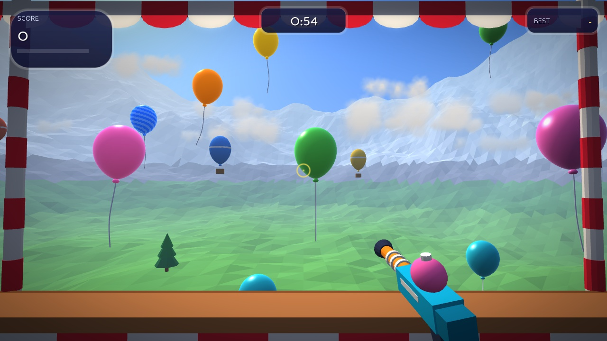
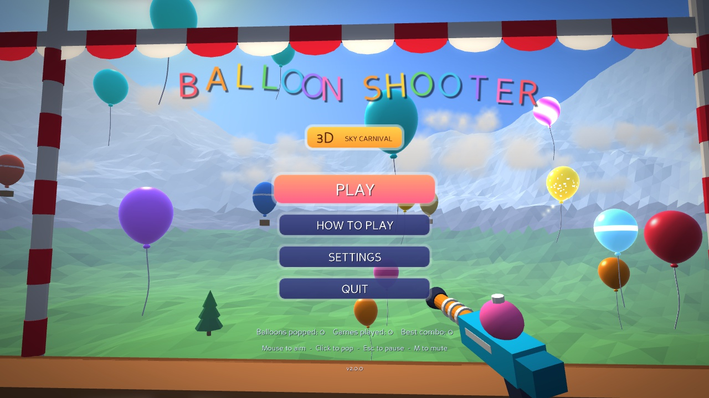
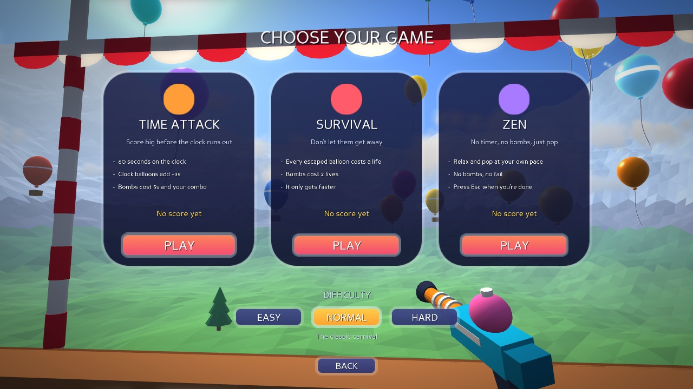
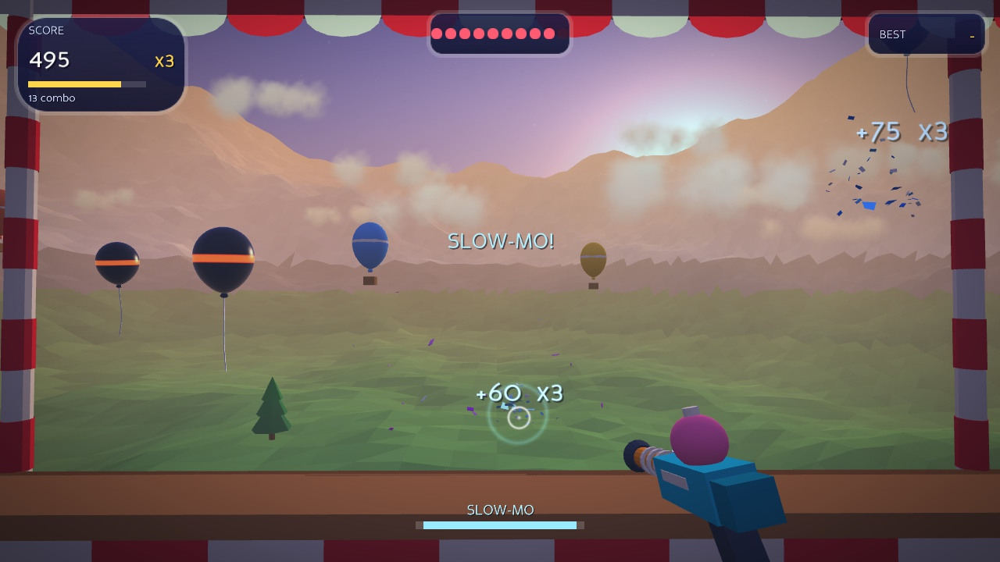
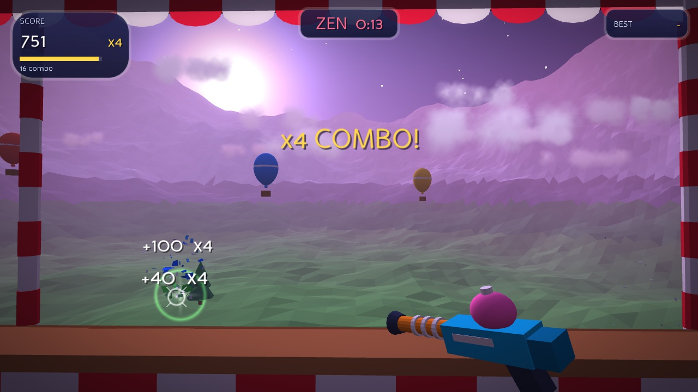
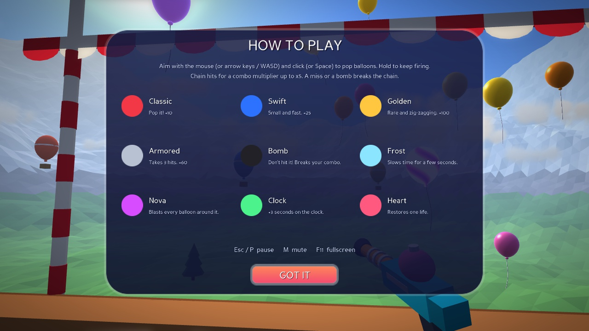
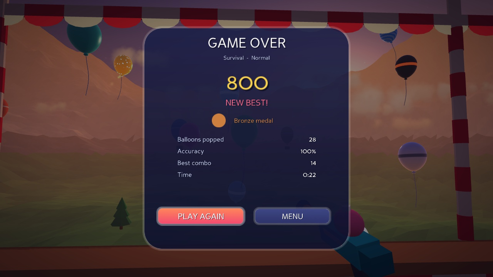

# Balloon Shooter 3D — Sky Carnival

A 3D carnival shooting gallery built in **Python** with the **Panda3D** engine. Step up to the booth on a
cliff above a sunny valley, grab your toy blaster and pop every balloon floating up into the sky.
Easy for kids to pick up, with plenty of depth (combos, specials and medals) for score chasers.



## Features

- **Real 3D world.** A procedural valley with mountains, a lake, pine trees, drifting clouds and hot-air
  balloons, plus a carnival booth framing the view. Every mesh is generated in code.
- **Custom GLSL shaders.** Glossy rubber balloons with rim light and light shining through, metallic gold
  and armour, glowing bomb fuses, swirling nova energy and a gradient sky with sun and stars.
- **Post-processing.** Bloom, colour grading, vignette, a slow-motion tint and impact flashes.
- **Game feel.** Confetti and rubber-shred bursts, shockwave rings, tracers, floating score text, screen
  shake, a blaster with recoil, and a crosshair that reacts to what you aim at.
- **Three modes, three difficulties.** Best scores and medals are saved per mode and difficulty.
- **Nine balloon types.** Each has its own look and effect (see below).
- **Original sound and music.** Every effect and both music loops are synthesized from scratch
  (`tools/generate_audio.py`).
- **Accessible.** Keyboard-only aiming, hold-to-fire, aim assist on Easy, a Zen mode with no fail state, and
  a toggle to turn screen shake off.

| | |
|---|---|
|  |  |
|  |  |
|  |  |

## Game modes

| Mode | Goal | Sky |
|---|---|---|
| **Time Attack** | Score as much as you can in 60 seconds. Clock balloons buy extra time; bombs cost 5 s. | Sunny day |
| **Survival** | You have 10 lives and every balloon that escapes costs one. It keeps getting faster. | Sunset |
| **Zen** | No timer, no bombs, no fail. Pop at your own pace and press Esc when you're done. | Dusk |

Difficulty (**Easy / Normal / Hard**) changes balloon speed, size, spawn rate, how many bombs appear and the
amount of aim assist.

## Balloons

| Balloon | Effect |
|---|---|
| Classic | +10 points, in seven colours |
| Swift | Small and fast, +25 |
| Golden | Rare, zig-zags, leaves a sparkle trail, +100 |
| Armored | Takes three hits, +60 |
| Bomb | Don't hit it! Breaks your combo (and costs time or lives) |
| Frost | Slows time for 5 seconds |
| Nova | Blasts every balloon around it (and safely defuses bombs) |
| Clock | +3 seconds (Time Attack, when the clock runs low) |
| Heart | Restores a life (Survival) |

Hit balloons back to back to build a **combo**. Every 5 hits raises the multiplier, up to **x5**. Missing or
hitting a bomb resets it.

## Controls

| Action | Mouse | Keyboard |
|---|---|---|
| Aim | Move the mouse | Arrow keys / WASD |
| Shoot (hold for auto-fire) | Left click | Space |
| Pause | | Esc or P |
| Mute | | M |
| Fullscreen | | F11 |
| Menus | Click | Arrows / Tab, then Enter or Space |

## Install and play

Requires Python 3.9 or newer.

```bash
pip install -r requirements.txt
python main.py
```

Useful options:

```bash
python main.py --mode survival --difficulty hard   # skip the menu
python main.py --size 1600x900 --windowed           # window size
python main.py --mute                                # no audio
python main.py --help                                # everything else
```

Settings and scores are saved to your user data folder: `%APPDATA%\BalloonShooter3D` on Windows,
`~/Library/Application Support/BalloonShooter3D` on macOS and `~/.local/share/balloon-shooter-3d` on Linux.

## Project layout

```
main.py                    entry point
balloon_shooter/
  app.py                   command line and engine configuration
  game.py                  state machine, input, shooting, events, camera
  rules.py                 scoring, combos, lives, timers, spawn pacing (engine-free, unit tested)
  config.py                balloon catalogue, modes, difficulties, skies
  balloons.py              balloon entities, spawning and hit tests
  world.py                 sky, terrain, clouds, scenery and the booth
  effects.py               particles, tracers, score popups and the blaster
  shaders.py               GLSL shaders (GLSL 1.20, so macOS works too)
  post.py                  bloom and colour-grading pipeline
  hud.py / menus.py / ui.py  interface
  geometry.py              procedural meshes and textures
  audio.py / storage.py    sound and save data
assets/                    font (Fredoka) and generated sounds
tools/generate_audio.py    rebuilds every sound effect and music loop
tests/                     unit tests and a headless smoke test
legacy/                    the original 2D pygame version
```

## Development

```bash
pip install -r requirements-dev.txt
pytest                      # rules, picking and save-file tests
ruff check .

# full game smoke test with the autoplay bot (needs a display, or xvfb on Linux)
BALLOON_SHOOTER_SMOKE=1 xvfb-run -a pytest tests/test_smoke.py

# regenerate the sounds and music
python tools/generate_audio.py
```

`--autoplay`, `--screenshot T:PATH` and `--quit-after N` let the built-in bot play and capture screenshots,
which is how the images above were made.

## The original

This started as a simple 2D pygame game: click red and blue balloons for 30 seconds. That version is kept
in [`legacy/`](legacy/) (`python legacy/main.py`, needs `pygame`).

## Credits

- Font: [Fredoka](https://github.com/hafontia/Fredoka-One) by the Fredoka Project Authors, SIL Open Font
  License 1.1 (see `assets/fonts/OFL.txt`).
- Engine: [Panda3D](https://www.panda3d.org/) (BSD licence).
- All 3D models, textures, sound effects and music are generated procedurally by this project.
